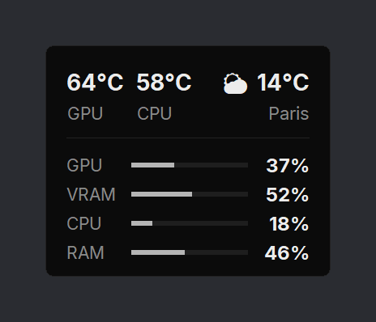

# SimpleOverlay

A tiny, dark and discreet system overlay for Windows.

<p align="center">
  
</p>

- **GPU and CPU temperature**, plus **GPU, VRAM, CPU and RAM usage**
- **Current weather** of any city ([Open-Meteo](https://open-meteo.com/), free, no API key), refreshed every 10 minutes
- Always on top, borderless, drag it anywhere (the position is remembered)
- Values turn amber, then red, when they get high
- Sharp at any Windows display scale (100 %, 125 %, 150 %…)
- Bundled [Inter](https://rsms.me/inter/) font (SIL Open Font License), nothing is installed system-wide
- Starts with Windows and **updates itself** from the overlay: a small dot appears when a new version is available
- Lightweight: refreshes once per second, redraws only what changed
- Interface in English or French, following the Windows language

## Installation

**Option 1:** download [`install.bat`](https://raw.githubusercontent.com/OgdenLeGrand/SimpleOverlay/main/install.bat) (right-click → *Save link as…*) and double-click it.

**Option 2:** in PowerShell:

```powershell
irm https://raw.githubusercontent.com/OgdenLeGrand/SimpleOverlay/main/install.ps1 | iex
```

The exe is installed in `%LOCALAPPDATA%\SimpleOverlay`, with a desktop shortcut. Windows asks for administrator approval **once**, for the CPU temperature (see below). You can decline it: the overlay then works without that value.

You can also download `SimpleOverlay.exe` directly from the [latest release](https://github.com/OgdenLeGrand/SimpleOverlay/releases/latest).

## Usage

| Action | Effect |
|---|---|
| Left-click and drag | Move the overlay |
| Double-click the weather | Pick another city (the picker closes when you click elsewhere) |
| Right-click | Menu: city, opacity, start with Windows, CPU temperature, updates, quit |

GPU temperature, usage and VRAM are read through NVML on **NVIDIA** cards, and through the built-in sensors on other cards.

The overlay shows on top of games running in borderless windowed mode, not in exclusive fullscreen.

## CPU temperature

Windows only exposes the CPU temperature to programs that have administrator rights and a driver. SimpleOverlay bundles the [LibreHardwareMonitor](https://github.com/LibreHardwareMonitor/LibreHardwareMonitor) library and uses the [PawnIO](https://pawnio.eu/) driver (signed, open source).

During installation, a single administrator approval:

- installs PawnIO if it isn't already there;
- creates two scheduled tasks (`SimpleOverlay` and `SimpleOverlay Startup`) that start the overlay with administrator rights, **without any prompt afterwards**: at logon, and when you use the shortcut.

If the approval was declined: right-click the overlay → **Enable CPU temperature (admin)…**. The menu then shows *CPU temperature ✓*.

## Troubleshooting

Errors (weather, updates, CPU temperature) are logged to `%USERPROFILE%\.simpleoverlay.log`. Settings are stored in `%USERPROFILE%\.mini_overlay.json`.

## Uninstall

Double-click [`uninstall.bat`](https://raw.githubusercontent.com/OgdenLeGrand/SimpleOverlay/main/uninstall.bat) (it asks for administrator rights to remove the scheduled tasks). The PawnIO driver is kept; you can remove it from *Windows Settings → Apps*.

## Development

Run from source:

```bash
pip install psutil nvidia-ml-py certifi pythonnet
pythonw overlay.py
```

The CPU temperature requires the `lhm/` folder (built by the CI from NuGet, see `tools/collect_lhm.py`) and the Inter font requires `fonts/` (`tools/get_fonts.ps1`).

### Releasing a new version

1. Edit `overlay.py` and bump `VERSION` (e.g. `1.7.2` → `1.8.0`).
2. Push to `main`.

GitHub Actions then builds `SimpleOverlay.exe` on Windows (with LibreHardwareMonitorLib and Inter), tests it, and publishes the `v1.8.0` release. Installed overlays offer it at their next check (at startup, then every 6 hours, or right away via right-click → *Check for updates*).

## Credits

- [LibreHardwareMonitor](https://github.com/LibreHardwareMonitor/LibreHardwareMonitor) (MPL 2.0) and [PawnIO](https://pawnio.eu/) for hardware sensors
- [Inter](https://rsms.me/inter/) by Rasmus Andersson (SIL Open Font License 1.1)
- [Open-Meteo](https://open-meteo.com/) for weather data
